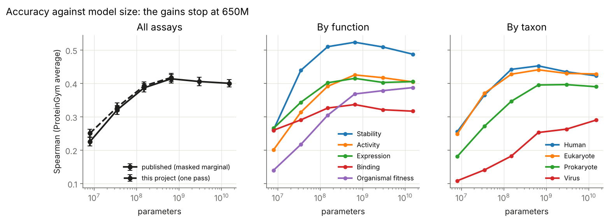
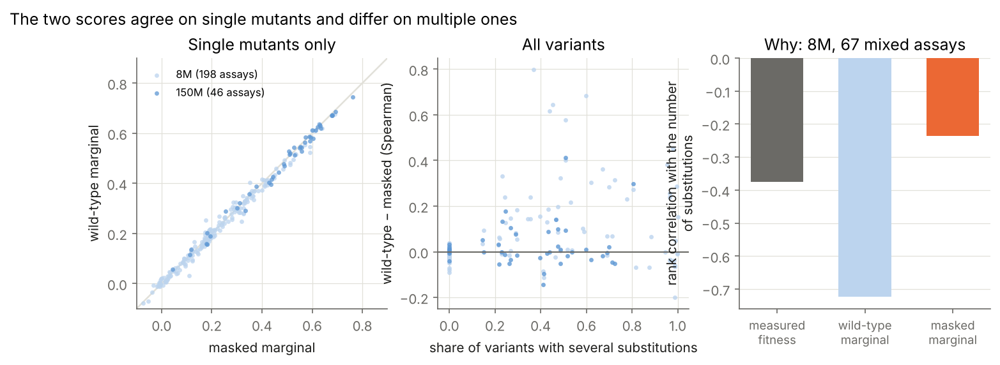
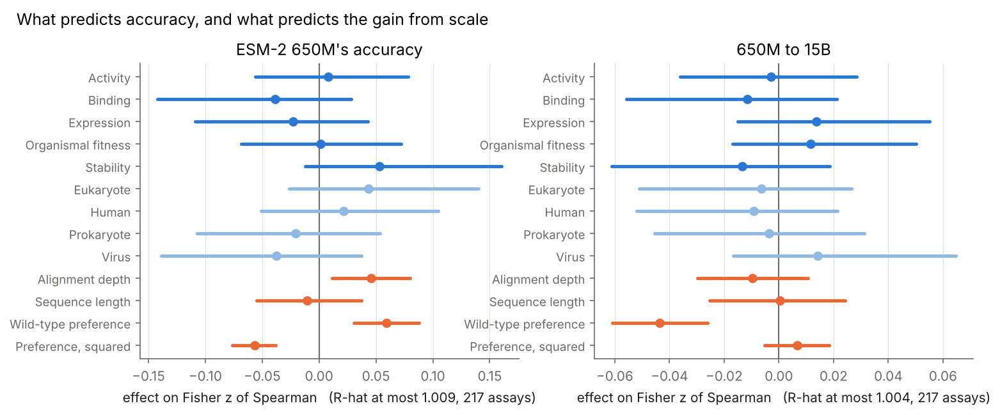
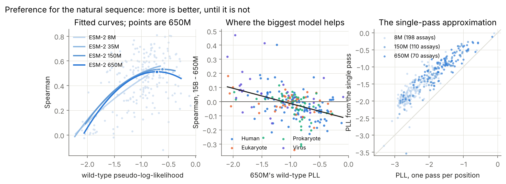

# What a protein language model knows about mutations

[](https://github.com/jackcormacwright1/protein-lm-variant-effects/actions/workflows/tests.yml)

ESM-2 is trained only on natural protein sequences, with no measurements at all, yet the probabilities it
assigns to amino acids predict what mutations do. This project scores all 217 of ProteinGym's deep mutational
scans with four sizes of ESM-2 and asks four questions: how well it works and how cheaply, which proteins it
fails on, whether a bigger model is better, and how many measurements it takes to beat it.



All of it runs on two CPU cores — 2.1 hours of compute in total, no GPU.

## Headline findings

1. **The expensive way of scoring buys nothing on single mutants, and loses on multiple ones.** ProteinGym
   scores ESM models with the *masked marginal*: mask each mutated position in turn, one forward pass per
   position. One pass over the unmasked sequence gives every position at once, a median of 150 times cheaper
   per assay. On single mutants the two are equivalent (per-assay Spearman 0.201 against 0.205 at 8M, 0.465
   against 0.471 at 150M). On assays where variants carry several substitutions the cheap score is clearly
   better (0.418 against 0.267 at 8M), because measured fitness falls with the number of substitutions and
   the masked score barely tracks that: its rank correlation with the mutation count is −0.24, against −0.72
   for the one-pass score and −0.38 in the data itself. The unmasked model is far more confident in the
   wild-type residue (mean log probability −0.41 against −2.45), so each substitution subtracts more, and the
   sum over several of them carries the count. Over the whole benchmark the cheap score is ahead at every
   size: 0.251 against 0.226 at 8M, 0.417 against 0.414 at 650M.

   

2. **Bigger stops helping at 650M, and the average hides two opposite movements.** Published accuracy rises
   from 0.226 (8M) to 0.414 (650M) and then falls: 0.406 at 3B, 0.400 at 15B. Underneath, 15B gains most on
   viral proteins (+0.037) and loses most where the protein has many known relatives (−0.054 on high
   alignment depth).

3. **What predicts accuracy is how much the model already likes the protein — not what was measured on it.**
   A partially pooled regression of per-assay accuracy (Fisher *z*, 217 assays, 186 proteins) finds two
   features that matter: alignment depth (+0.046 per standard deviation, 90% interval +0.012 to +0.080) and
   the model's preference for the natural sequence, which has a clear optimum. The squared term is negative
   in 100% of posterior draws, with the maximum at a pseudo-log-likelihood of −0.77 (−0.91 to −0.58): too
   little preference and the model has nothing to say, too much and every substitution looks equally bad.
   Sequence length adds nothing once those are in. Neither does what was measured or which organism it came
   from: every function and taxon effect straddles zero, and the spread across proteins (0.135) is twice the
   spread across functions (0.065). Which protein it is matters more than what was done to it.

   

4. **Scale helps exactly where the smaller model liked the sequence least.** Modelling the *change* from 650M
   to 15B the same way, the only predictor is 650M's own preference for the wild type (−0.043 per standard
   deviation, negative in 100% of draws, and with no optimum this time — the relationship is a straight
   line). The apparent gain on viral proteins is mostly this: they are the sequences the smaller model
   prefers least. This is the inverted-U of Gordon, Lu and Abbeel (2025) read in reverse: scale buys more
   preference, which helps only until it has gone too far.

   

## Reproducing ProteinGym

Scored ProteinGym's way, this project's per-assay Spearman matches its published ESM-2 numbers to within
0.0005 on every assay checked, and `tests/test_core.py` checks that the aggregation reproduces the published
summary table from the published per-assay numbers.

## What's here

| | |
|---|---|
| `src/plm/data.py` | loading ProteinGym's assays, parsing mutants |
| `src/plm/scoring.py` | ESM-2 scoring: masked and wild-type marginals, windows for long proteins, the single-pass pseudo-likelihood |
| `src/plm/evaluate.py` | ProteinGym's aggregation, per-assay Spearman, the scoring-method comparison |
| `src/plm/hierarchy.py` | the partially pooled regression of per-assay accuracy |
| `src/plm/fewshot.py` | ridge baselines and learning curves under the three splits |
| `scripts/score_assays.py` | score every assay with one model and one method (resumable) |
| `scripts/run_analysis.py` | the assay table, the scaling table and the hierarchical models |
| `scripts/run_fewshot.py` | the learning curves (resumable) |
| `scripts/make_figures.py` | the charts in `results/` |
| `app.py` | the Streamlit dashboard |
| `docs/METHODOLOGY.md` | what was done and why, with the formulas |

## Running it

```bash
pip install -e ".[models,analysis,app]"

# 1. ProteinGym's assay files and CV splits into data/, ESM-2 weights into ../esm_weights
#    (https://proteingym.org and https://github.com/facebookresearch/esm)
# 2. score every assay, four sizes, one pass per protein
for m in 8M 35M 150M 650M; do python scripts/score_assays.py --model $m --strategy wt; done
#    and the expensive way, for the comparison
python scripts/score_assays.py --model 8M --strategy masked
# 3. tables, hierarchical models, learning curves, figures
python scripts/run_analysis.py
python scripts/run_fewshot.py
python scripts/make_figures.py
streamlit run app.py
```

`data/` holds only the reference tables; the assay files (1.4 GB) and the model weights (3.2 GB) are not in
the repository.

## Credits

[ProteinGym](https://proteingym.org) (Notin et al., 2023), MIT licensed: the assays, the splits and the
published baselines, which this project reproduces and builds on.
[ESM-2](https://github.com/facebookresearch/esm) (Lin et al., 2023), MIT licensed, via `fair-esm`.

## References

- Fieller, Hartley and Pearson (1957). Tests for rank correlation coefficients. *Biometrika* 44, 470–481.
- Gordon, Lu and Abbeel (2025). Protein language model fitness is a matter of preference. *ICLR*.
- Hsu, Nisonoff, Fannjiang and Listgarten (2022). Learning protein fitness models from evolutionary and
  assay-labeled data. *Nature Biotechnology* 40, 1114–1122.
- Lin et al. (2023). Evolutionary-scale prediction of atomic-level protein structure with a language model.
  *Science* 379, 1123–1130.
- Meier et al. (2021). Language models enable zero-shot prediction of the effects of mutations on protein
  function. *NeurIPS*.
- Notin et al. (2023). ProteinGym: large-scale benchmarks for protein fitness prediction and design.
  *NeurIPS*.
